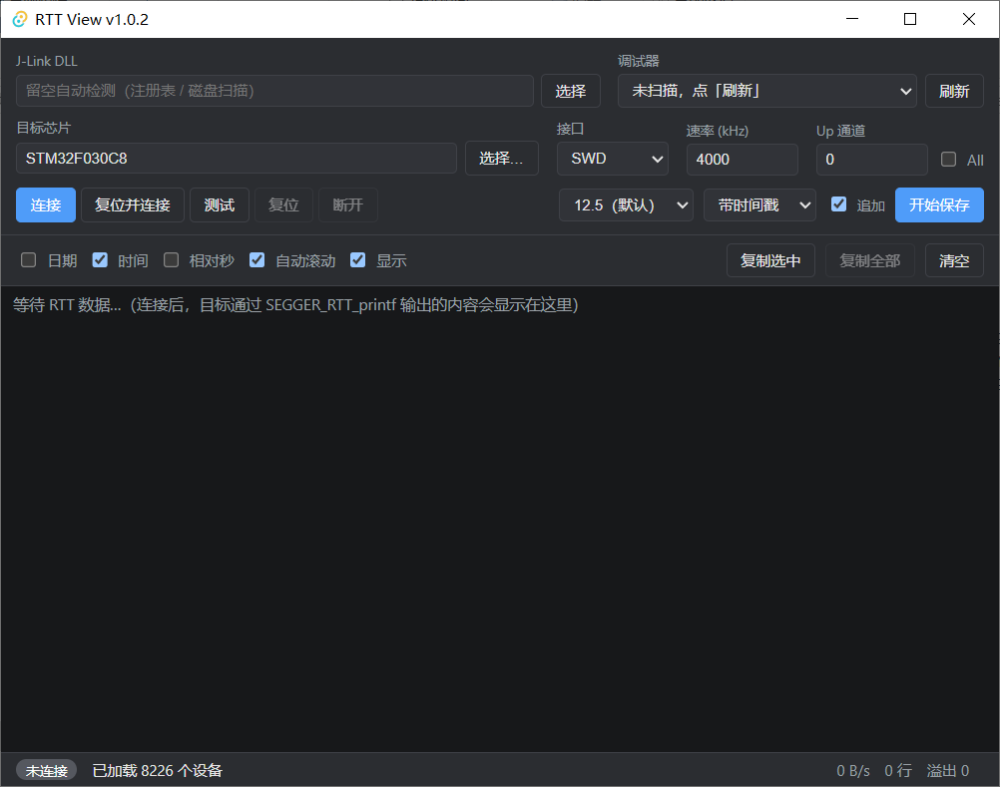

# RTT View

一个 Windows 上位机，用来查看 SEGGER J-Link **RTT** 输出并自动添加**系统时间戳**。
SEGGER 自带的 RTT Viewer 不会在日志前加时间戳，本项目补上这一点，同时提供类串口工具的
日志能力：按行复制、保存到文件（含 CSV）。

界面基于 **Tauri v2 + WebView2**，采集与 J-Link DLL 的交互全部在 **Rust** 后端完成。

当前版本 **v1.0.3**（窗口标题会显示版本号）。



*主界面：上方为连接面板（DLL / 调试器 / 芯片 / 接口 / 速率 / Up 通道，以及连接·复位并连接·
测试·复位·断开；该行右端为日志字号、保存格式、追加、开始保存），中间为日志工具栏
（日期·时间·相对秒·自动滚动·显示 / 复制选中·复制全部·清空），下方为日志区与状态栏。*

## 功能

- 通过 SEGGER J-Link 读取 RTT Up Channel，按行重组为日志
- 每行添加**主机接收时间戳**（日期 / 时间可分别开关，另有会话相对秒）
- 日志字号可选（默认 12.5px，另有一档更小、三档更大）
- 自动定位 J-Link DLL：注册表 → 常见路径扫描 → 手动指定
- 按需枚举 J-Link 调试器（点「刷新」或首次连接时触发），多调试器时可选择
- **抑制 SEGGER DLL 的弹窗**：未插调试器时不会弹出 "Emulator selection" 对话框，调试器选择完全在本界面完成
- 目标芯片从 **J-Link DLL 内置设备库**中选择，用**弹窗表格**（厂商 / 设备 / 内核 / RAM / Flash，可搜索）
  - 芯片名**只能从弹窗列表里选**（主页那个显示型号的输入框是只读的），选后用 `JLINKARM_DEVICE_GetIndex` 向 DLL 校验
  - 之所以用弹窗而非原生 `<datalist>`：后者无法套用 CSS，也承载不了数千条带列的数据
  - 设备库是内嵌在 DLL 里的（本机 V6.88a 有 8226 个设备）；`JLinkDevices.xml` 只是自定义扩展文件，只有几百条，**不能**当作设备全集
- SWD / JTAG、速率、RTT Up 通道配置
  - Up 通道支持 **All**：轮询目标的所有 Up 通道，无需事先知道固件用的是哪个（J-Link API 没有"一次读全部"的调用，所以是逐通道轮询，每通道独立重组，日志会标注 `[ch0 (Terminal)]` 这样的来源）
- 「测试连接」：只建立会话并验证 RTT 控制块，不开始采集
- 「复位」：通过 J-Link 复位目标并**保持运行**（`JLINKARM_ResetNoHalt`，而非会停机的
  `JLINKARM_Reset`），随后自动重新等待 RTT 控制块就绪，复位后无需重连即可继续看日志
  - ⚠️ **复位是否有效取决于所选型号是否与实物一致。** J-Link 会**按选中的型号挑选复位策略**；
    型号填错时它用的那套流程对真实芯片可能无效，表现为**复位静默失败**（不报错但目标没重启）。
    典型例子：实际是某国产 Cortex-M4，却在列表里选了 nRF52，RTT 照样能连、能打印，
    但复位不生效——因为 RTT 读内存与复位是两回事，不依赖型号正确。**请尽量选与实物一致的型号**；
    库里没有的芯片可退而选通用 `Cortex-M4` 这类条目。
  - ⚠️ 目前只用 `JLINKARM_ResetNoHalt()`，它返回 `void`，**无法验证复位是否真的发生**；
    复位失败时可能仍报"目标已复位并继续运行"。若遇到该情况，请先核对型号。
  - 若芯片的复位引脚（nRESET）未接到调试器，依赖复位引脚的策略会失败。例如 nRF52 的复位引脚
    **默认是关闭的**（`UICR.PSELRESET` 复位值为 `0xFFFFFFFF`），此时需用不依赖该引脚的复位方式。
- 「复位并连接」按钮（在「连接」右侧）：连接时先复位目标再让它运行，等价于 Keil 下载时的
  Reset and Run。**刚用 Keil 烧录且未勾选 Reset and Run 时，芯片停在复位向量、固件没有运行，
  普通「连接」会失败，此时用「复位并连接」即可恢复。** 「连接」按钮不做复位，适合目标本来就
  在正常运行的情况（若内核处于停住状态，后端仍会自动 `Go` 让它继续跑）
- 日志窗口：文本可选、`Ctrl+C`、复制选中 / 复制全部、清空、自动滚动（选择文本时自动暂停）
- 保存到文件：带时间戳 / 原始数据 / CSV 三种格式，支持追加或覆盖
- 配置持久化（记住上次的连接参数与界面开关）

## 环境要求

- Windows 10 1803+ / Windows 11（内置 WebView2）
- 已安装 **SEGGER J-Link 软件包**（提供 `JLink_x64.dll` 与 `JLinkDevices.xml`）
- 开发：Rust（MSVC 工具链）、Node.js 与 pnpm

> **注意**：本程序不随包分发 `JLinkARM.dll` / `JLink_x64.dll`，需要用户自行安装官方
> J-Link 软件包（许可限制）。程序会在启动时自动查找该 DLL。

## 开发

```bash
pnpm install
pnpm tauri dev
```

前端单元测试（纯函数逻辑，无需浏览器与硬件）：

```bash
pnpm test
```

覆盖：芯片过滤与键盘导航（`device-filter`）、自动滚动的判定（`smooth-scroll`）、连接状态徽章
（`connection-state`）、数值格式化（`format`）、日志字号档位（`log-font`）、空状态提示（`log-view`）。

后端测试：

```bash
cd src-tauri && cargo test
```

打包（单文件便携版）：

```bash
pnpm build:portable
```

产物为**单个 exe**，约 4.3 MB，路径：`src-tauri/target/release/rtt-view.exe`。

前端资源已编译进二进制，**不需要**旁边的 `dist/` 文件夹；拷到别的电脑双击即可运行
（`bundle.targets` 设为 `[]`，因此不会产出、也不会去联网下载 NSIS/WiX 安装包）。

### 运行前提（两个，无法通过打包消除）

1. **目标机需安装 SEGGER J-Link 软件包**（程序运行时加载 `JLink_x64.dll`）。
   该 DLL 受 SEGGER 许可限制不能随包分发。未安装时会提示"未找到 J-Link DLL"，
   也可在界面里手动指定 DLL 路径。
2. **目标机需有 Microsoft Edge WebView2 运行时**。Windows 10（1803 及以上）与
   Windows 11 通常已自带；精简版/服务器版可能缺失。程序启动时会检测，缺失则弹出
   中文提示并给出官方下载地址，而不是静默退出。

WebView2 的用户数据存放在 `%LOCALAPPDATA%\com.rttview.app\EBWebView\`（Tauri 默认），
**不会**在 exe 旁边生成文件——所以 exe 放在只读目录也能运行。程序自身的设置则在
`%APPDATA%\com.rttview.app\settings.json`。

## 使用

1. 连接好 J-Link 与目标板，给目标上电。
2. 启动程序。若 DLL 自动定位成功，调试器下拉框会显示已连接的 J-Link。
   - 若未找到 DLL，点「选择」手动指定 `JLink_x64.dll`（一般在 J-Link 安装目录下）。
3. 点「选择…」打开芯片弹窗，输入关键字搜索（如 `STM32F407`、`Cortex-M4`）并选中目标型号。
   **尽量选与实物一致的型号**：型号决定了 J-Link 采用的连接与复位策略，填错时 RTT 通常仍能
   正常连接和打印，但**复位可能静默失效**（详见上文「复位」条目）。库里没有的芯片可选通用型号。
4. 选择接口（SWD/JTAG）与速率，点「测试」确认能连上，再点「连接」。
5. 目标固件通过 `SEGGER_RTT_printf(0, "...")` 输出的内容会显示在日志窗口，并带时间戳。
6. 需要留存时点「开始保存」选择文件；停止时自动 flush。

## 时间戳语义（重要）

日志里的时间是**主机收到数据的时间**，包含 USB 传输、调试链路、RTT 缓冲与轮询延迟，
适合判断"大概什么时候打印的"，**不适合**做亚毫秒级的时序测量。若需要精确的事件时间，
应在固件侧给日志加上 DWT 周期计数器（`DWT->CYCCNT`）或 SysTick 计数再打印。

RTT 默认工作在 SKIP 模式（缓冲满则丢弃），高负载下会丢数据，状态栏的「溢出」计数会体现
这一点。对丢包敏感时，可在固件中调大 Up Buffer 或改用阻塞模式。

## 关于 J-Link 弹窗（已处理）

未插 J-Link 调试器时，SEGGER DLL 在被要求枚举调试器（`JLINKARM_EMU_GetList`）后会启动
`JLinkGUIServer.exe` 并弹出 "Emulator selection" 对话框抢焦点。本程序采取两层措施：

1. **抑制 DLL 的 GUI**：DLL 加载后立即执行 SEGGER 官方命令字符串
   `SuppressGUI 1`、`SuppressEmuUSBDialog 1`、`HideDeviceSelection 1`、`SuppressControlPanel`
   （在 `JLINKARM_Open` 之前，符合官方要求的时机），让 DLL 保持无界面。
2. **按需枚举**：启动时不再自动扫描调试器，只有点「刷新」或首次点「连接/测试」时才枚举，
   调试器选择完全由本界面负责。

回归检查见 `src-tauri/examples/gui_stress.rs`：该工具反复调用枚举并统计 `JLinkGUIServer`
进程数，可用来确认抑制仍然有效。

**运行中拔掉调试器也会弹窗（已修复）。** 现象是连接正常时突然拔掉 J-Link，界面显示未连接，
但会不停弹出要求输入 J-Link IP 地址的对话框，关掉又弹。根因不是枚举，而是**连接断开后仍在
调用 RTT 命令**：

- `JLINK_RTTERMINAL_Control`（`GETSTAT`/`GETNUMBUF`/`READ`，**也包括 `STOP`**）在 DLL 已关闭且
  后面没有调试器时，会让 DLL 转为在网络（IP）上寻找调试器，弹出对话框，并且**该调用本身会
  一直阻塞**，直到对话框被处理。
- 于是 `teardown()` 里的 `rtt_stop()`（拔线时的收尾）会先卡住；状态栏的 1 秒统计 tick 又在
  无条件调用 `GETSTAT`，因此对话框关掉后立刻被重新弹出，看起来"关不掉"。
- 而 `JLINKARM_IsOpen` / `JLINKARM_Open` / `JLINKARM_Close` 在这一状态下都是安全的（能立即
  返回）。

修复：RTT 命令只在会话有效时下发（`rtt_query_allowed`），断线路径改用
`teardown_after_loss()`（不做 `rtt_stop`）。统计 tick 在无会话时保留上次的溢出计数，不再查询
DLL。该状态的对照实验见 `src-tauri/examples/api_watch.rs`（`control` 与 `probe` 两个 mode 差别
仅在最后一次 RTT 调用；`probe` 会阻塞，`control` 立即返回）。

## 关于连接（几个易踩的坑）

**1. `JLINKARM_Connect` 会把 CPU 停住（halt）。** 停住后固件不再运行、不再打印，RTT 看起来就是
"连上了但收不到数据"。程序在连接后会检查 `JLINKARM_IsHalted`，若已停住则调用 `JLINKARM_Go`
恢复运行（SEGGER 的 RTT Viewer 也是这个行为）。

**2. `GETSTAT.IsRunning` 不能当作"RTT 就绪"的判据。** 实测（V6.88a）它在发出 START 后
**立刻返回 1**，此时控制块还没找到、缓冲数仍为 0。可靠的信号是 **Up 缓冲数量**（`GETNUMBUF`），
它在控制块就绪后才变为非 0（已运行的目标上约 200-500ms）。`rtt_start` 因此等待缓冲数而非
`IsRunning`；同时 START **只发一次**，重发会重启控制块搜索、反而拖慢收敛。

**3. `JLINKARM_EMU_SelectByUSBSN` 在 DLL 已打开时必然返回 -1。** 连接序列的第一句就是选调试器，
所以只要上一次会话还开着（例如自动连接刚成功、用户又点了「连接」），第二次连接就会在第
一步失败并报"选择调试器失败，错误码 -1"。`open_session` 因此在选调试器**之前**先调用
`reset_session()` 关闭任何遗留会话——并且以 `JLINKARM_IsOpen` 的实际状态为准，而不是只信
自己的标志位。

**失败提示会区分两个阶段。** 连接失败时状态栏会说明是哪一步出了问题：
- 「连接失败」——调试器没能连上芯片（接线、供电、芯片型号、调试器被其它程序占用等）。
- 「芯片已连接，但未找到 RTT 控制块 — 请尝试「复位并连接」」——已经连上芯片，
  但固件没有在运行/RTT 没初始化。**刚烧录过（Keil 未勾 Reset and Run）时就是这个提示**。

**4. 调试器被其它程序占用时，`Open` 会失败并报 "Failed to open DLL"。**
J-Link 调试器同一时刻只能被一个程序使用。Keil 的调试会话（或它残留的后台进程）等软件会持有它，
此时无论选择调试器还是 `Open` 都会失败。请先结束 Keil 的调试会话（或退出 Keil）再连接。

**5. 单调试器时不再调用 `SelectByUSBSN`。** 实测该调用即使在"调试器已插好、枚举可见、
序列号完全匹配"的情况下也会返回 -1（间歇性，且与 DLL 是否已打开无关）。由于它只是
多调试器场景下的选择手段，单调试器时改为"自动选择"（`Open` 会挑唯一调试器），从根上避开它；
后端也在选择失败时容错重试，仅当存在多个调试器且无法确定时才报错。

回归检查见 `src-tauri/examples/session_replay.rs`（重复连接）、`rtt_start_compare.rs`（就绪判据）
和 `rtt_read_check.rs`（端到端读到数据）。

## 架构

```
Tauri 窗口 (WebView2)
 ├─ 连接面板：DLL / 调试器 / 芯片 / 接口 / 速率 / 通道 / 连接·复位并连接·测试·复位·断开
 │            ＋右侧：日志字号 · 保存格式 · 追加 · 开始保存
 ├─ 工具栏：  日期·时间·相对秒·自动滚动·显示 / 复制选中·复制全部·清空
 └─ 状态栏：  连接状态 · 速率 · 行数 · 溢出 · 已保存
        ▲ Channel（批量日志行）        │ invoke 命令
Rust 后端
 ├─ discovery.rs   注册表 + 磁盘扫描定位 DLL
 ├─ jlink/sys.rs   J-Link DLL 的原始 FFI 声明与结构体（含 size_of/offset 单测）
 ├─ jlink/mod.rs   安全封装（加载 / 调试器 / 连接 / RTT 读写 / 设备库枚举）
 ├─ acquisition.rs 唯一采集线程：连接时序、轮询、行重组、时间戳、批量下发
 ├─ line_assembler.rs 字节流按行重组（含 UTF-8 跨包处理）
 ├─ logging.rs     文件写入（带时间戳 / 原始 / CSV）
 ├─ config.rs      设置持久化
 ├─ state.rs       应用状态（采集句柄 + 设置的持有者）
 ├─ dialog.rs      启动前的原生错误提示框（WebView2 缺失等）
 ├─ webview2.rs    启动前检测 WebView2 运行时
 └─ commands.rs    Tauri 命令层
```

**关键约束**：J-Link DLL 是进程级单例且不可重入，因此**所有 DLL 调用都集中在采集线程**
（`acquisition.rs`），其它线程只通过命令通道与它通信。

**DLL 独占**：通过 DLL 连接时程序独占该调试器，不能同时打开 J-Link RTT Viewer / GDB Server。
DLL 一旦加载即常驻，更换 DLL 需重启程序。

## 关于 FFI 常量

`jlink/sys.rs` 中的结构体布局与常量数值来自 J-Link SDK 头文件（`JLinkARM.h` /
`JLink_RTTERMINAL.h`，V6.9x 系列），并经过 `struct_layout_matches_sdk` 单测校验
（例如 `JLINKARM_EMU_CONNECT_INFO` 必须为 264 字节）。修改这些定义前请先跑该测试。

## 尚未包含

波形绘图、串口 / CAN、MDF4 读写、协议编辑器与 MCU 代码生成、FFT、命令控制台、
仪表盘、固件侧 DWT 时间戳、多调试器并行采集。
